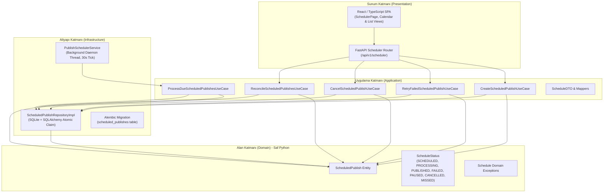
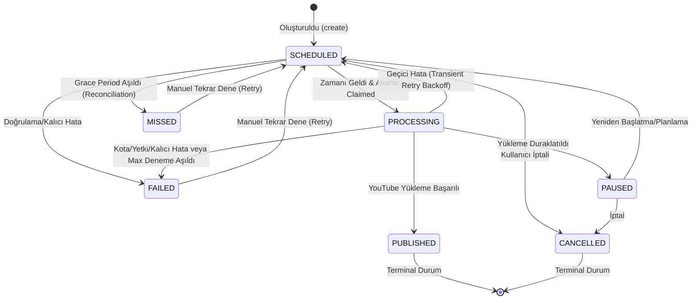

# Tezlify AI Video Studio — Yayın Takvimi ve Otomatik Zamanlayıcı Mimarisi (Aşama 3)

**Tarih:** 3 Kasım 2026  
**Durum:** Üretim Kalitesinde / Tamamlandı  
**Mimari Katman:** Clean Architecture + Hexagonal Ports & Adapters  

---

## 1. Genel Bakış

Aşama 3, Tezlify AI Video Studio'nun yerel video kütüphanesindeki içerikleri ileri tarihli olarak YouTube kanalına yayınlama kabiliyetini sağlamaktadır. Sistem; kullanıcı müdahalesi olmadan zamanı gelen yayınları arka planda bağımsız bir thread/worker ile işler, SQLite üzerinde iyimser sürüm kilitlemesi (optimistic concurrency version lock) ile çoklu iş parçacığı yarış durumlarını (race condition) engeller ve uygulama yeniden başlatıldığında veya bilgisayar uyku modundan çıktığında görevleri otomatik uzlaştırır (startup reconciliation).

---

## 2. Clean Architecture Katman Dağılımı



---

## 3. Durum Yaşam Döngüsü ve Geçiş Kuralları (State Machine)

`ScheduledPublish` varlığı sıkı durum geçiş matrisine (`VALID_TRANSITIONS`) sahiptir. Geçersiz geçişler anında `InvalidScheduleStateTransitionException` fırlatır:



---

## 4. Eşzamanlılık Güvenliği ve İyimser Sürüm Kilitleme (Optimistic Concurrency Locking)

Arka planda çalışan birden fazla scheduler döngüsü veya worker aynı anda tetiklense dahi, aynı görevin iki defa işlenmesi ve YouTube'a mükerrer yüklenmesi SQL seviyesinde engellenmiştir:

```sql
UPDATE scheduled_publishes 
SET status = 'processing', 
    version = :expected_version + 1, 
    attempt_count = attempt_count + 1,
    started_at = :now_utc,
    updated_at = :now_utc
WHERE id = :id 
  AND version = :expected_version 
  AND status = 'scheduled';
```

- SQLite üzerinde `cursor.rowcount == 1` kontrol edilir.
- Yalnızca kazanan tekil thread işlemi devralır (`claim_for_processing = True`).
- Diğer tüm worker'lar bu işlemi atlar (`claim_for_processing = False`).

---

## 5. Zaman Dilimi ve DST (Yaz/Kış Saati) Yönetimi

1. **Depolama Standardı:** SQLite veritabanında `scheduled_at_utc` kolonu daima saf UTC zaman damgası (`timezone.utc`) olarak saklanır.
2. **Kullanıcı Tercihi:** Kullanıcının seçtiği veya tarayıcısından otomatik tespit edilen IANA zaman dilimi (örn: `Europe/Istanbul`, `America/New_York`) `timezone` kolonunda tutulur.
3. **DST Duyarlılığı:** Giriş yapılan ISO-8601 string'i (örn. `2026-11-04T15:30:00+03:00`) parse edilirken ve gösterilirken Python `datetime.astimezone(timezone.utc)` ile yaz saati değişimleri kayıpsız dönüştürülür. Naive (zaman dilimi belirtilmemiş) girişler API seviyesinde `422 Unprocessable Entity` ile reddedilir.
