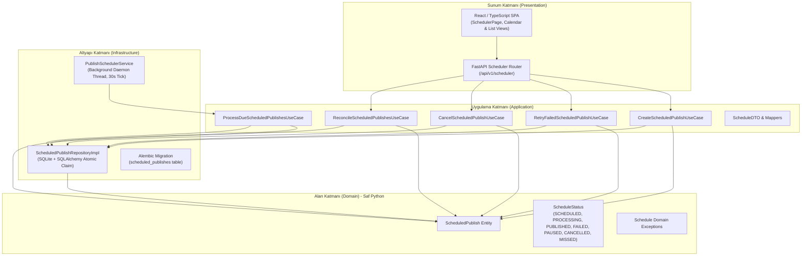
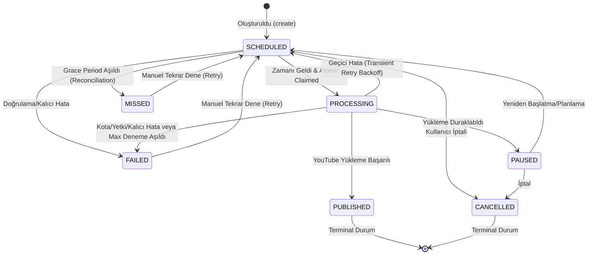

# Tezlify AI Video Studio — Yayın Takvimi ve Otomatik Zamanlayıcı Mimarisi (Aşama 3)

**Tarih:** 3 Kasım 2026  
**Durum:** Üretim Kalitesinde / Tamamlandı  
**Mimari Katman:** Clean Architecture + Hexagonal Ports & Adapters  

---

## 1. Genel Bakış

Aşama 3, Tezlify AI Video Studio'nun yerel video kütüphanesindeki içerikleri ileri tarihli olarak YouTube kanalına yayınlama kabiliyetini sağlamaktadır. Sistem; kullanıcı müdahalesi olmadan zamanı gelen yayınları arka planda bağımsız bir thread/worker ile işler, SQLite üzerinde iyimser sürüm kilitlemesi (optimistic concurrency version lock) ile çoklu iş parçacığı yarış durumlarını (race condition) engeller ve uygulama yeniden başlatıldığında veya bilgisayar uyku modundan çıktığında görevleri otomatik uzlaştırır (startup reconciliation).

---

## 2. Clean Architecture Katman Dağılımı



---

## 3. Durum Yaşam Döngüsü ve Geçiş Kuralları (State Machine)

`ScheduledPublish` varlığı sıkı durum geçiş matrisine (`VALID_TRANSITIONS`) sahiptir. Geçersiz geçişler anında `InvalidScheduleStateTransitionException` fırlatır:



---

## 4. Eşzamanlılık Güvenliği ve İyimser Sürüm Kilitleme (Optimistic Concurrency Locking)

Arka planda çalışan birden fazla scheduler döngüsü veya worker aynı anda tetiklense dahi, aynı görevin iki defa işlenmesi ve YouTube'a mükerrer yüklenmesi SQL seviyesinde engellenmiştir:

```sql
UPDATE scheduled_publishes 
SET status = 'processing', 
    version = :expected_version + 1, 
    attempt_count = attempt_count + 1,
    started_at = :now_utc,
    updated_at = :now_utc
WHERE id = :id 
  AND version = :expected_version 
  AND status = 'scheduled';
```

- SQLite üzerinde `cursor.rowcount == 1` kontrol edilir.
- Yalnızca kazanan tekil thread işlemi devralır (`claim_for_processing = True`).
- Diğer tüm worker'lar bu işlemi atlar (`claim_for_processing = False`).

---

## 5. Zaman Dilimi ve DST (Yaz/Kış Saati) Yönetimi

1. **Depolama Standardı:** SQLite veritabanında `scheduled_at_utc` kolonu daima saf UTC zaman damgası (`timezone.utc`) olarak saklanır.
2. **Kullanıcı Tercihi:** Kullanıcının seçtiği veya tarayıcısından otomatik tespit edilen IANA zaman dilimi (örn: `Europe/Istanbul`, `America/New_York`) `timezone` kolonunda tutulur.
3. **DST ve Duvar Saati Doğrulaması:** `schedule_timezone_validator.py` servisi ile:
   - **İleri Saat (Spring Forward) Boşluğu:** Saat 02:00 -> 03:00 atlamasında yerel saatte var olmayan hayali zamanlar (örn. 02:30) tespit edilir ve kullanıcıya açıkça `422 Unprocessable Entity` ("Belirtilen saat yaz saati geçişi nedeniyle bu zaman diliminde mevcut değildir") hatası verilir.
   - **Geri Saat (Fall Back) Belirsizliği:** Saat 01:00 -> 02:00 tekrarında ambiguous (çift) zamanlar IANA offset uyumuyla doğrulanır.
   - Naive (zaman dilimi belirtilmemiş) girişler API seviyesinde doğrudan reddedilir.

---

## 6. Güvenilirlik, İdempotens ve Çökme Kurtarma Mimarisi (Aşama 3.1)

Aşama 3.1 denetimi sonucunda scheduler sistemine endüstriyel standartta güvenilirlik ve idempotens katmanları entegre edilmiştir:

### 6.1. SQLite Eşzamanlılık ve Kilit Güçlendirmesi
SQLite bağlantılarında WAL (Write-Ahead Logging) moduna ek olarak:
- `PRAGMA busy_timeout = 10000;` (10 saniye bekleme, `database is locked` hatasını önler)
- `PRAGMA synchronous = NORMAL;` (Veri bütünlüğünü bozmadan yüksek yazma performansı)
aktif kılınmıştır.

### 6.2. Çift Katmanlı İdempotens Koruması (Duplicate Publish Prevention)
Kullanıcının aynı videoyu mükerrer olarak YouTube'a yüklemesini imkansız kılmak için iki bağımsız bariyer inşa edilmiştir:
1. **Medya Varlığı Seviyesi:** Bir `MediaAsset` için daha önce tamamlanmış (`PublishStatus.PUBLISHED`) bir yayın kaydı mevcutsa, scheduler ve publish use case'leri yeni yükleme oturumu açmaz; görevi derhal `PUBLISHED` olarak uzlaştırır.
2. **Aktif Yükleme Çakışması:** Aynı medyaya ait `UPLOADING` veya `PAUSED` durumunda bir oturum varsa, eşzamanlı yeni bir yayın başlatılamaz (`PublishConflictException`).

### 6.3. Uzak Başarı / Yerel Başarısızlık Ayrışması (Remote Success / Local Failure Divergence)
YouTube HTTP 200 yanıtı verip `video_id` döndükten hemen sonra yerel işlem çökerse (örn. SQLite yazma hatası, SIGKILL, güç kesintisi):
- `ScheduledPublish.publish_record_id` `NULL` kalmış olsa dahi, sistem yeniden başlatıldığında (`ReconcileScheduledPublishesUseCase`) ilgili `media_id` üzerinden tamamlanan kayıt tespit edilir.
- Görev hiçbir koşulda tekrar YouTube'a gönderilmez; otomatik olarak `PUBLISHED` durumuna geçirilir.

### 6.4. Kesilen Son Parçada Resumable Upload Kurtarma (Video ID Recovery)
Yüklemenin son parçası gönderilirken istemci bağlantısı kopsa ve YouTube HTTP 200 yanıtı istemciye ulaşamasa:
- Yeniden başlatmada `query_upload_status` çağrılır.
- YouTube HTTP 200/201 döndüğünde yanıt gövdesindeki video ID `UploadStatusResult` veri yapısıyla kurtarılır.
- `ResumeYouTubeUploadUseCase`, sıfır parça yüklemesiyle kaydı doğrudan `PUBLISHED` durumuna alır ve `external_video_id` alanını günceller.

### 6.5. Zarif Kapanma ve İşlem Kesintisi (Graceful Stop Interception)
Sunucu kapanırken (`lifespan shutdown`):
- Arka plan işçisi `_stop_event.is_set()` durumunu her HTTP parça (chunk) yüklemesi öncesinde denetler.
- Devam eden yükleme zarifçe `PAUSED` durumuna çekilir (`SERVER_STOPPING` hata kodu ile).
- Veri kaybı veya soket sızıntısı yaşanmadan işlem sonlandırılır.
