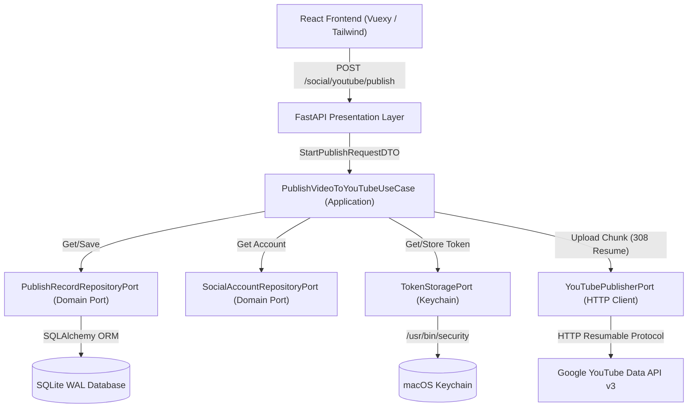

# YouTube Publisher Mimari Dokümantasyonu

## 1. Genel Bakış
Tezlify AI Video Studio Aşama 2 (YouTube Publisher), yerel stüdyoda üretilen veya içe aktarılan videoları doğrudan kullanıcının YouTube kanalına aktaran güvenli, dayanıklı ve Clean Architecture prensiplerine tam uyumlu bir yayınlama motorudur.

## 2. Clean Architecture Katman Dağılımı

### Domain Katmanı (Saf Python - 0 Harici Bağımlılık)
- **Entities**:
  - `SocialAccount`: Platform, hesap adı, kanal ID, avatar, aktiflik durumu ve token geçerlilik süresi.
  - `PublishRecord`: Video yayınlama oturumu, başlık, açıklama, etiketler, kategori, gizlilik, yükleme ilerlemesi, durum makinesi.
- **Enums**:
  - `SocialPlatform`: `YOUTUBE`
  - `PrivacyStatus`: `PUBLIC`, `UNLISTED`, `PRIVATE`
  - `PublishStatus`: `PENDING`, `AUTHENTICATING`, `UPLOADING`, `PAUSED`, `PROCESSING`, `PUBLISHED`, `FAILED`, `CANCELLED`, `REQUIRES_REAUTH`
- **Exceptions**:
  - `PublishDomainException`, `SocialAccountNotFoundException`, `InvalidPublishStateTransitionException`, `DuplicatePublishException`, `QuotaExceededException`, `TokenStorageException`, `AuthenticationRequiredException`

### Application Katmanı (Use Cases & Ports)
- **Ports**:
  - `YouTubePublisherPort`: OAuth URL oluşturma, token takası, profil çekme, chunk yükleme, durum sorgulama.
  - `SocialAccountRepositoryPort`: Sosyal medya hesabı kalıcılık arayüzü.
  - `PublishRecordRepositoryPort`: Yayın kayıtları kalıcılık arayüzü.
  - `TokenStoragePort`: Güvenli token saklama arayüzü.
- **Use Cases**:
  - `GenerateYouTubeAuthUrlUseCase`: RFC 7636 PKCE S256 anahtar çifti ve state oturumu üretir.
  - `CompleteYouTubeAuthenticationUseCase`: Gelen kodu verifier ile takas edip Keychain'e kaydeder.
  - `GetConnectedYouTubeAccountUseCase`: Aktif hesabı ve token geçerliliğini denetler.
  - `DisconnectYouTubeAccountUseCase`: Hesabı siler ve Keychain'deki tokenları imha eder.
  - `PublishVideoToYouTubeUseCase`: Google Resumable Upload oturumunu başlatır, 4MB chunklar halinde yükler, ilerlemeyi veritabanına yazar.
  - `ResumeYouTubeUploadUseCase`: Kesintiye uğramış yüklemeyi Google sunucusundaki son byte'tan devam ettirir.
  - `CancelYouTubeUploadUseCase`: Devam eden yüklemeyi iptal eder.

### Infrastructure Katmanı (Adapters)
- `YouTubeApiClientImpl`: `httpx` tabanlı Google YouTube API v3 istemcisi.
- `KeychainTokenStorageAdapter`: macOS `/usr/bin/security` komut satırı aracı ile işletim sistemi Keychain entegrasyonu (test fallback'li).
- `SocialAccountRepositoryImpl` & `PublishRecordRepositoryImpl`: SQLite + SQLAlchemy ORM adaptörleri.

### Presentation Katmanı
- FastAPI router: `/api/v1/social/youtube/*`
- React/TypeScript bileşenleri:
  - `YouTubeConnectionCard`: Yetkilendirme durumu, kanal kartı, pop-up tetikleyici.
  - `YouTubePublishModal`: Video seçim, başlık, açıklama, kategori ve gizlilik formu.
  - `PublishProgressCard`: Canlı yükleme yüzdesi, aktarılan byte miktarı, duraklatma ve iptal.
  - `PublishHistoryTable`: Geçmiş yayınlar ve YouTube izleme linkleri.

## 3. Durum Makinesi (Publish State Transitions)
Yayın kayıtları yalnızca izin verilen durumlara geçiş yapabilir:
- `PENDING` -> `AUTHENTICATING`, `UPLOADING`, `CANCELLED`, `FAILED`
- `AUTHENTICATING` -> `UPLOADING`, `REQUIRES_REAUTH`, `FAILED`, `CANCELLED`
- `UPLOADING` -> `PAUSED`, `PROCESSING`, `PUBLISHED`, `FAILED`, `CANCELLED`, `REQUIRES_REAUTH`
- `PAUSED` -> `UPLOADING`, `CANCELLED`, `FAILED`
- `PROCESSING` -> `PUBLISHED`, `FAILED`
- `REQUIRES_REAUTH` -> `AUTHENTICATING`, `PENDING`, `CANCELLED`
- `PUBLISHED` -> (Son durum / Terminal state)
